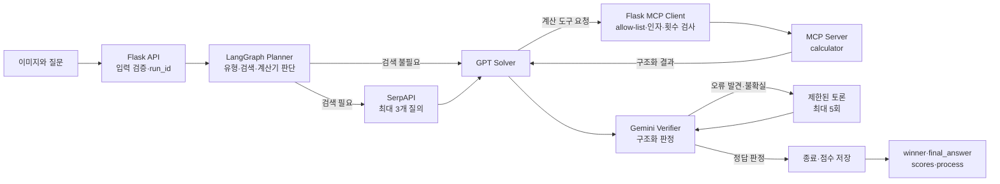

# GemPT-AI-Lab

**GemPT를 출발점으로, 이미지 문제 풀이에 제한된 Agent 실행 흐름과 외부 도구를 연결하고 그 동작을 측정하는 실험 프로젝트입니다.**

GemPT의 GPT 풀이·Gemini 검증 구조를 이어받아 LangGraph 기반 분기, MCP 계산기, 실행 상태 저장, 기준선 비교용 평가기를 더했습니다. 핵심 목표는 “모델을 더 붙였다”가 아니라 **언제 도구를 쓰고, 결과를 어떻게 검증하며, 실패와 품질을 어떻게 관찰할지**를 명시하는 것입니다.

> **현재 단계:** 핵심 경로와 컨테이너는 구현되어 있습니다. Compose의 API/MCP health 상태를 확인했습니다. `gemini-3.8-flash`는 간단한 일반 텍스트와 구조화 응답 모두 `503`을 반환했고, 같은 구조화 응답을 `gemini-3.6-flash`로 보내 성공을 확인해 로컬 Compose 설정을 3.6 Flash로 전환했습니다. 수정 후 전체 `/api/solve` 성공 여부, 정량 성능 비교, Kubernetes 클러스터 배포는 아직 확인 전입니다. 따라서 정확도·비용·속도 향상을 주장하지 않습니다.

## 한눈에 보기

| 항목 | 설명 |
|---|---|
| 출발점 | 이미지 속 문제를 GPT가 풀고 Gemini가 검토하는 기존 GemPT |
| 확장 이유 | 한 번의 요청 안에서 모델·도구가 어떤 순서로 동작했는지 추적하고, 분기와 실패를 통제하며, 개선 여부를 재현 가능하게 비교하기 위해 |
| 주요 추가 | LangGraph, 제한된 MCP calculator, 조건부 검색, 실행 체크포인트, 고정 평가 사례와 집계기, Docker Compose 및 Kubernetes 매니페스트 |
| API | Flask `POST /api/solve`; 기존 `winner`, `final_answer`, `scores`, `process` 응답 필드 유지 |
| 검증 원칙 | 구현된 기능, 실제 관측한 동작, 아직 측정하지 않은 결과를 분리 |

## GemPT에서 GemPT-AI-Lab으로

### 기존 GemPT

기존 GemPT는 이미지 문제를 받아 GPT가 풀이를 생성하고 Gemini가 답안을 검토하는 듀얼 LLM 문제 풀이 서비스입니다. 두 모델의 역할 분리는 유용했지만, 순차적인 호출 흐름만으로는 실행 상태, 조건부 도구 사용, 중간 실패, 기준선 대비 효과를 체계적으로 다루기 어려웠습니다.

### 확장 과정

1. **기존 경험과 API를 보존했습니다.** Flask와 `/api/solve` 계약을 유지해 기존 사용 흐름을 이어갑니다.
2. **실행 단계를 명시했습니다.** LangGraph가 계획, 검색, 풀이, 도구 호출, 검증, 토론, 종료를 노드와 조건부 전이로 표현합니다.
3. **필요할 때만 도구를 쓰도록 했습니다.** 계획기가 문제 유형을 분류하고 검색·계산기 필요 여부를 선택합니다. 검색은 최대 3개 질의, calculator는 요청당 최대 3회로 제한됩니다.
4. **모델과 도구 사이에 통제 경계를 뒀습니다.** Solver가 calculator를 요청해도 Flask가 도구명과 인자를 검사한 뒤 MCP 서버를 호출합니다.
5. **비교할 수 있는 발판을 마련했습니다.** 기존 순차 경로를 legacy 기준선으로 보존하고, 고정 사례와 관측 결과를 나눠 집계하는 평가기를 추가했습니다.

## 처리 흐름



각 요청에는 `run_id`가 부여되고 단계별 이벤트가 `process`에 기록됩니다. LangGraph 체크포인트에는 이어서 실행하는 데 필요한 상태와 이미지 참조가 저장됩니다. 이미지 바이트는 그래프 상태에 직접 넣지 않고 `/data/uploads`의 파일로 보관하며, 체크포인터는 SQLite를 사용합니다. 체크포인트 저장은 구현되어 있지만, 외부 실행 상태 조회·취소·재개 API까지 제공하는 것은 아닙니다.

## 무엇이 달라졌나

| 영역 | 기존 GemPT에서 이어받은 것 | GemPT-AI-Lab에서 추가한 것 | 기대 효과와 현재 한계 |
|---|---|---|---|
| 모델 역할 | GPT 풀이, Gemini 검증 | 계획기·Solver·Verifier 작업을 명시 | 실행 책임이 분명해짐. 모델이 항상 옳다는 보장은 없음 |
| 흐름 제어 | 순차적인 풀이·검증 | LangGraph 노드, 상태, 조건부 분기와 종료 경로 | 어느 단계에서 실패했는지 추적 가능. 성능 개선은 별도 측정 필요 |
| 도구 | 모델 응답에 의존 | MCP calculator, allow-list·입력 검증·시간/호출 제한 | 계산 실행을 통제하고 결과를 풀이 흐름에 전달. 결과 반영률은 아직 측정 전 |
| 검색 | 문제와 무관하게 검색될 수 있는 구조 | 계획기가 선택할 때만 SerpAPI 검색 | 불필요한 검색 호출을 줄일 수 있는 구조. 실제 절감량은 미측정 |
| 상태와 입력 | 요청 중 메모리 중심 처리 | `run_id`, SQLite 체크포인트, 파일 기반 이미지 참조 | 추적과 상태 보관을 개선. 장애 후 안전한 재개 정책은 제한적 |
| 평가 | 개별 답변 확인 | legacy/LangGraph 실행 기록과 고정 사례 집계기 | 같은 사례로 비교할 기반. 현재 사례 수와 입력 형식으로는 일반 성능 결론 불가 |
| 실행 환경 | Flask 애플리케이션 | Compose 서비스 분리와 Kubernetes 매니페스트 | 로컬 통합·배포 학습 기반. Kubernetes 실제 배포는 미확인 |

## 기술 선택과 트레이드오프

| 기술 | 맡은 역할 | 선택 이유 | 감수한 점 / 다른 선택과 비교 |
|---|---|---|---|
| **Flask** | 기존 HTTP API와 업로드 처리 | 기존 GemPT를 유지하며 Agent 흐름을 점진적으로 붙이기 쉬움 | 비동기·타입 중심 API가 핵심이면 FastAPI가 대안이지만, 전면 이전은 범위와 회귀 위험을 키우므로 하지 않음 |
| **LangGraph** | 상태가 있는 실행 그래프와 조건부 전이 | 계획→검색/생략→풀이→도구→검증→토론처럼 반복·분기를 코드 구조로 드러냄 | 단순 직선 호출에는 과할 수 있고 그래프 상태 설계가 추가됨. 자유 자율성 대신 제한된 상태 전이를 택함 |
| **MCP** | 계산 도구 서버와 클라이언트 사이의 표준 인터페이스 | 도구 기능을 모델 제공자·API 코드와 분리하고, 허용된 도구만 호출하도록 경계를 둘 수 있음 | 계산 하나만 보면 직접 함수 호출이 더 단순함. 별도 프로세스와 프로토콜 운영 비용을 감수하며 확장 가능한 도구 연결을 실험 |
| **GPT·Gemini** | GPT는 계획·풀이, Gemini는 독립 검증 | 생성과 검토를 분리해 단일 응답보다 오류를 발견할 기회를 마련 | 두 번 이상의 모델 호출로 지연·비용·외부 API 의존성이 증가. 모델 간 합의도 정답 증거는 아님 |
| **SerpAPI** | 검색이 선택된 사례의 외부 정보 수집 | 최신·외부 사실이 필요한 문제에 선택적으로 근거를 제공 | 외부 검색은 잡음·비용·지연·프롬프트 인젝션 위험이 있어 필요할 때만 제한적으로 사용 |
| **SQLite 체크포인터 + 파일 저장소** | 실행 상태와 이미지 참조 보관 | MVP에서 별도 데이터베이스 없이 재현 가능한 상태 기록과 큰 입력의 분리를 구현 | 로컬 단일 인스턴스에 적합. 다중 복제본·운영 고가용성에는 공유 DB/객체 저장소가 필요 |
| **Docker Compose** | API와 MCP의 로컬 통합 | 로컬에서 서비스 주소·의존성·헬스체크를 재현 | 클러스터 오케스트레이션은 제공하지 않으므로 Kubernetes와 역할을 분리 |
| **Kubernetes** | API/MCP 배포 리소스와 저장 볼륨 선언 | Deployment·Service·PVC 등 운영 기본 개념을 검증할 배포 대상을 제공 | 매니페스트가 있다는 것과 실제 클러스터 배포 성공은 다름. 현재 클러스터 적용은 확인되지 않음 |

## 성능은 어떻게 평가할까?

이 프로젝트의 성능은 “모델을 추가했으니 좋아졌다”로 판단하지 않습니다. `legacy`와 `langgraph`에 **같은 사례·모델·프롬프트 조건**을 주고 다음을 비교해야 합니다.

- **풀이 품질:** 기준 답과의 일치율, 설명 루브릭 점수, 검증 후 정답률
- **계획 품질:** 검색과 calculator 각각의 precision·recall·F1 및 불필요 호출률
- **도구 효과:** 도구 결과 성공률, Solver의 결과 반영 여부, calculator 허용/비허용 조건의 정답률 차이
- **운영 효율:** 요청 전체 지연의 p50/p95, 모델·검색·도구 호출 횟수, 토큰과 요청별 비용, 오류율
- **재현성:** 모델·프롬프트·데이터셋 버전, 실행 횟수, 분자/분모, 실패 사례 기록

현재 평가 데이터는 소규모 text-only 시작 세트입니다. 실제 이미지 인식, 검증 후 정확도, 도구에 의한 답 교정률, 비용·단계별 지연을 주장하려면 라벨이 있는 실제 이미지 사례, 노드별 계측, 도구 전후 답 기록이 더 필요합니다. 평가 설계와 현재 지표의 한계는 [평가 안내](docs/evaluation.md)와 [검증 실행서](docs/validation-runbook.md)를 참고하세요.

## 구현 및 검증 현황

### 구현된 항목

- 기존 Flask API와 응답 필드를 유지하면서 LangGraph 경로를 연결했습니다.
- 문제 유형에 따른 조건부 검색·calculator 계획과 제한을 추가했습니다.
- MCP calculator 서버, Flask MCP Client, 구조화 도구 결과 경로를 구현했습니다.
- `run_id`, 단계별 `process`, SQLite 체크포인트, 이미지 파일 참조 저장을 추가했습니다.
- legacy와 LangGraph 관측치를 다루는 평가 데이터·실행기·집계기를 추가했습니다.
- API와 MCP Docker 이미지, Compose 설정, Kubernetes 매니페스트를 준비했습니다.

### 실제 확인된 항목과 남은 검증

- **확인:** API와 MCP 이미지 빌드, 두 컨테이너의 Compose health 상태, API 컨테이너의 Flask 시작과 `/healthz` 200 응답.
- **확인:** 실제 `/api/solve` 실행에서 planner와 GPT 풀이까지 진행됐지만, Gemini의 구조화 검증 요청이 `400 INVALID_ARGUMENT`로 실패했습니다. 오류 원인은 Gemini가 스키마의 `additionalProperties`를 지원하지 않은 것이었습니다.
- **수정 및 단위 smoke 확인:** 검증 스키마에서 `additionalProperties`를 제거했습니다. 이후 같은 컨테이너에서 `gemini-3.8-flash`는 일반 텍스트·구조화 요청 모두 `503`을 반환했고, `gemini-3.6-flash` 구조화 요청은 성공했습니다. `.env`의 Compose 모델 설정을 3.6 Flash로 바꾸고 API 컨테이너에 적용했습니다.
- **전체 경로 재검증 필요:** 모델 설정 변경 후 실제 `/api/solve`가 Gemini 검증까지 성공하는지는 아직 확인하지 않았습니다.
- **미확인:** 위 실제 `/api/solve` 사례는 planner가 calculator를 선택하지 않아 MCP 도구 경로를 검증하지 않았습니다. 별도의 calculator 호출 성공은 API 전체 경로 성공과 구분합니다.
- **미확인:** Kubernetes 매니페스트 적용, Pod readiness, API→MCP 호출, PVC 재시작 후 데이터 보존.
- **미측정:** legacy 대비 정확도·비용·지연 개선. 현재 수치로 성능 향상을 주장하지 않습니다.

README와 상태 보고는 설정 파일이 존재하는 사실과 실제 실행을 관측한 사실을 구분합니다. 배포 절차는 [Kubernetes 안내](docs/kubernetes.md), 전체 기술 맥락은 [프로젝트 방향·면접 안내](docs/project-direction-and-interview-guide.md)를 참고하세요.

## 실행 방법

### Docker Compose

저장소 루트의 `.env`에 다음 변수를 설정합니다. 실제 키는 커밋하지 마세요.

```dotenv
OPENAI_API_KEY=...
GOOGLE_API_KEY=...
SERPAPI_API_KEY=...
GEMINI_MODEL_NAME=gemini-3.6-flash
```

API와 MCP를 빌드하고 실행합니다.

```powershell
docker compose up -d --build
docker compose ps
```

컨테이너가 `healthy`가 된 뒤 health endpoint를 확인합니다. 첫 시작은 이미지 빌드와 Flask 초기화 때문에 시간이 걸릴 수 있으므로 `Started` 직후보다는 `healthy` 상태를 확인한 다음 요청하세요.

```powershell
Invoke-RestMethod http://127.0.0.1:5000/healthz
```

이미지 문제 요청 예시는 [검증 실행서](docs/validation-runbook.md)에 있습니다. Compose 서비스와 볼륨에 대한 자세한 설명은 [Kubernetes/로컬 실행 안내](docs/kubernetes.md)를 참고하세요.

### API 계약

| Method | Endpoint | 설명 |
|---|---|---|
| `GET` | `/` | 웹 프론트엔드 |
| `GET` | `/healthz` | API readiness 확인 |
| `POST` | `/api/solve` | `multipart/form-data`: 필수 `image`, 선택 `question`, `project_id` |
| `GET` | `/api/scores/{project_id}` | 프로젝트별 GPT·Gemini 점수 |

`POST /api/solve`는 `winner`, `final_answer`, `scores`, `process`를 반환합니다. 상세 요청·응답 계약은 [API 명세](docs/api_spec.md)에 있습니다.

## 범위와 다음 단계

**MVP의 초점:** 제한된 문제 풀이 Agent, 하나의 MCP calculator, 추적 가능한 실행, 고정 사례 평가, 로컬 Compose 통합, Kubernetes 배포 정의입니다.

**현재 범위 밖:** 범용 자율 에이전트, 사용자 승인 없는 쓰기 도구, 운영급 다중 복제본·고가용성, 자동 자기 개선, 실사용자 데이터 기반 성능 주장입니다.

다음 검증 순서는 ① 스키마 수정 후 실제 `/api/solve` 성공 확인, ② calculator 필요 이미지에서 planner 선택과 API→MCP 결과 반영 확인, ③ 라벨 사례 확장과 legacy 비교, ④ 사용 가능한 Kubernetes context에서 readiness·서비스 연결·PVC 보존 관찰입니다.

## 문서

- [조건부 Agent 검증 실행서](docs/validation-runbook.md)
- [평가 설계와 지표](docs/evaluation.md)
- [API 명세](docs/api_spec.md)
- [MCP/Kubernetes 구현 워크플로](docs/agent-workflow.md)
- [Kubernetes 실행 안내](docs/kubernetes.md)
- [Agent 개념·면접 준비](docs/ai-agent-interview-concepts.md)
- [프로젝트 방향 및 면접 안내](docs/project-direction-and-interview-guide.md)
