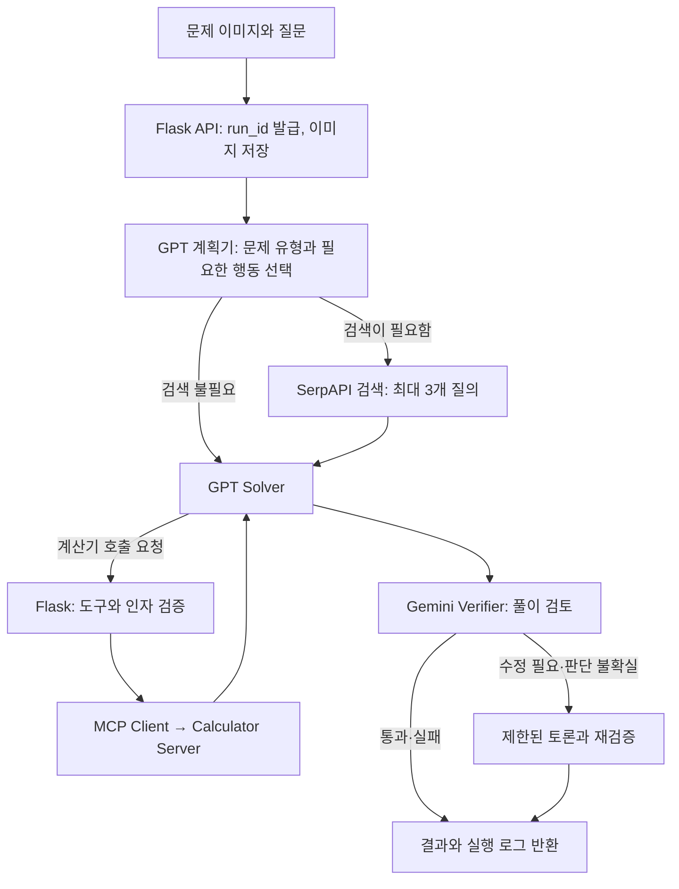

# GemPT-AI-Lab: Agent 개요와 MVP 계획

> **한 줄 요약**  
> 기존 GemPT의 이미지 문제 풀이·교차검증 기능에, 문제마다 필요한 행동을 고르는 제한된 Agent 흐름과 그 실행을 기록·평가하는 기반을 더하는 프로젝트입니다.

## 1. 프로젝트가 하려는 일

사용자가 이미지와 질문을 보내면 시스템은 문제를 풀고, 필요한 경우 외부 검색이나 계산기를 사용하며, 다른 모델의 검토 결과까지 반환합니다. 이때 중요한 것은 답만 내놓는 게 아니라 **어떤 선택을 했고, 어떤 도구를 사용했으며, 어디서 성공하거나 실패했는지 확인할 수 있게 하는 것**입니다.

현재 목표는 무제한으로 행동하는 자율 Agent를 만드는 것이 아닙니다. 정해진 작업 안에서 GPT가 검색·계산기 필요 여부를 판단하고, LangGraph가 허용된 단계·반복 횟수·종료 조건을 관리하는 **제한된 Agent 워크플로**를 만드는 것입니다.

## 2. 한 번의 요청은 이렇게 처리됩니다



1. Flask API가 이미지와 질문을 받고 실행 ID를 만듭니다.
2. GPT 계획기가 문제 유형을 분류하고, 검색 및 계산기 사용 여부를 선택합니다.
3. 검색이 필요한 경우에만 최대 3개의 검색 질의를 실행합니다.
4. GPT Solver가 풀이합니다. 계산이 필요하면 calculator 호출을 요청할 수 있습니다.
5. Flask 백엔드가 요청을 검사하고 MCP Client를 통해 계산기 서버를 호출합니다. 계산 결과는 Solver에게 돌아갑니다.
6. Gemini Verifier가 풀이를 `correct`, `correction_needed`, `uncertain` 중 하나로 평가합니다.
7. 수정이나 추가 검토가 필요하면 정해진 횟수 안에서 토론하고, 결과·점수·처리 과정을 반환합니다.

## 3. 각 구성 요소의 역할

| 구성 요소 | 쉽게 말하면 | 이 프로젝트에서 하는 일 |
|---|---|---|
| **GPT 계획기** | 작업 전에 세우는 짧은 실행 계획 | 문제 유형, 검색 필요 여부, 계산기 필요 여부를 JSON으로 정합니다. |
| **GPT Solver** | 문제 풀이 담당자 | 이미지와 질문을 읽고 단계별 풀이를 만듭니다. 필요하면 calculator 도구를 요청합니다. |
| **Gemini Verifier** | 풀이를 별도로 검토하는 담당자 | 이미지·질문·풀이·계산기 결과를 보고 구조화된 검증 결과를 냅니다. |
| **LangGraph Orchestrator** | 순서와 분기를 관리하는 진행 관리자 | 다음 노드, 도구 호출, 검증 반복, 오류 종료를 관리합니다. |
| **MCP Client** | 백엔드 쪽 도구 연결 담당 | 모델의 도구 요청을 검사한 후 승인된 MCP 도구에 전달합니다. |
| **MCP Calculator Server** | 실제 계산을 수행하는 별도 서비스 | 제한된 산술식을 계산하고 성공·실패 결과를 반환합니다. |
| **SQLite 체크포인터** | 실행 도중 상태를 저장하는 기록 장치 | 그래프 상태를 실행 ID별로 저장할 기반을 제공합니다. |
| **Kubernetes** | 서비스 실행·연결 환경 | API와 MCP 서버의 배포 설정, 상태 검사, 저장 공간 연결을 표현합니다. Agent의 판단을 담당하지 않습니다. |

여기서 GPT Solver와 Gemini Verifier라는 역할이 둘 있다고 해서 완전히 독립된 여러 Agent가 협상하는 시스템은 아닙니다. 하나의 LangGraph 흐름이 두 모델을 순서대로 호출하는 **역할 분리형 Agent 워크플로**라고 설명하는 편이 정확합니다.

## 4. 핵심 용어

### AI Agent

모델이 답변만 하는 것을 넘어, 요청을 보고 다음 행동을 고르고 도구를 사용하며, 결과를 다음 판단에 반영하는 애플리케이션 구조입니다. 이 프로젝트에서는 GPT 계획기와 Solver의 도구 선택이 Agent 행동에 해당합니다. 도구 권한과 반복 횟수는 모델이 마음대로 정하지 않고 백엔드와 LangGraph가 제한합니다.

### LangGraph

실행 상태를 공유하는 노드와 다음 단계로 가는 연결로 워크플로를 표현하는 라이브러리입니다. 이 프로젝트에서는 계획, 조건부 검색, 풀이, 계산기 호출, 검증, 토론, 종료를 관리합니다. **LangGraph를 썼다고 정답률이나 속도가 자동으로 올라가는 것은 아닙니다.** 실행 흐름을 명시하고 관찰하기 쉽게 만드는 것이 직접적인 목적입니다.

### MCP

Model Context Protocol의 약자입니다. 앱과 별도 도구 서버가 도구 이름·입력·결과를 주고받는 공통 통신 규격입니다. GPT가 MCP 서버에 직접 접속하는 것은 아닙니다.

```text
GPT가 calculator 호출을 요청
       ↓
Flask 백엔드가 이름·입력·호출 한도를 검사
       ↓
MCP Client가 MCP Calculator Server를 호출
       ↓
계산 결과를 Flask가 GPT에 전달
```

Function calling은 모델이 “이 도구를 이 인자로 호출하고 싶다”고 표현하는 방식이고, MCP는 백엔드가 별도 도구 서버와 통신하는 방식입니다. 서로 다른 역할입니다.

### Kubernetes

컨테이너를 Pod로 실행하고, Service 이름으로 서로 연결하며, 상태 검사와 저장 공간을 관리하는 플랫폼입니다. 계산이나 모델 검증을 더 똑똑하게 만들지는 않습니다. 현재는 배포용 매니페스트가 준비되어 있고, 실제 클러스터 적용 여부는 별도로 확인해야 합니다.

## 5. 실행 상태와 저장

- **`run_id`**: 한 번의 풀이 실행을 식별합니다.
- **`project_id`**: 프로젝트별 점수 기록을 구분합니다.
- **tool call ID**: 모델의 도구 요청과 해당 결과를 연결합니다.
- **`process` 이벤트**: 계획, 검색, MCP 호출, 검증, 오류, 점수 저장 단계를 API 응답에 기록합니다.
- **SQLite 체크포인트**: LangGraph의 실행 상태를 저장합니다.
- **이미지 참조**: 이미지 원본은 파일에 저장하고 그래프 상태에는 참조값만 둡니다.

체크포인트가 있다는 것만으로 실행이 자동 재시작되거나 사용자 대화가 이어지는 것은 아닙니다. 현재 `conversation_id` 기반 장기 대화 기억, 실행 상태 조회 API, 사용자 요청으로 중단 지점부터 재개하는 기능은 구현되어 있지 않습니다.

## 6. 도구 사용과 실패 제어

- 모델이 요청할 수 있는 계산 도구는 `calculator` 하나입니다.
- 도구 이름과 입력 형식을 백엔드에서 확인한 뒤 호출합니다.
- calculator 호출은 요청당 최대 3회입니다.
- 검증 토론은 최대 5회입니다.
- MCP 호출에는 시간 제한과 구조화된 오류 결과가 있습니다.
- Gemini 검증 호출이 실패하면 이를 “답이 맞다”는 뜻으로 취급하지 않습니다. 오류를 기록하고 추가 토론을 멈춥니다.
- 검색 결과는 신뢰된 지시가 아니라 참고 자료로 취급하도록 Solver 지침에 명시합니다.
- 임의 코드 실행을 피하기 위해 계산기는 Python `eval` 대신 허용된 산술 연산만 해석합니다.

모델 시간 초과에 대한 별도의 애플리케이션 재시도 정책이나 자동 실행 재개 기능이 있다고 말하면 안 됩니다. 향후 쓰기 도구를 추가한다면 사용자가 승인하기 전에 실제 변경을 실행하지 않는 정책이 필요합니다.

## 7. 평가: 무엇을 확인할 것인가

| 평가 질문 | 확인할 내용 |
|---|---|
| 풀이가 맞나? | 사람 기준 답안과 비교한 정확도, 설명 rubric, 무응답·실패 수 |
| 검색을 적절히 골랐나? | 검색 선택 정확도·precision·recall, 실제 검색 호출 수 |
| 계산기를 적절히 썼나? | 계산기 필요 여부 예측, 실제 호출, MCP 성공률 |
| 검증이 오류를 잡나? | 고정된 검증 사례에서 기대 판정과 실제 판정 비교 |
| 비용·속도는 달라졌나? | 요청 지연, 모델·검색 호출 수, token usage와 추정 비용 |
| 이미지 문제에서도 잘 되나? | 사람이 라벨링한 실제 이미지로 end-to-end 풀이 평가 |

기준선과 새 경로는 같은 문제 사례, 같은 이미지, 같은 질문, 같은 모델 조건으로 실행해야 합니다. 모델은 확률적으로 다른 답을 낼 수 있으므로 반복 횟수와 실패 분모를 기록해야 합니다. 점수 필드는 보정된 확률이나 모델의 실제 신뢰도가 아니라 기존 GemPT의 승패 기반 누적 점수입니다.

현재 평가 데이터는 작은 text-only 예제 중심입니다. 실제 이미지 인식 성능을 나타내지 않으며, 평가 러너도 요청별 비용이나 모든 그래프 노드의 지연을 자동 기록하지 않습니다. 성능 향상은 측정 결과가 나오기 전까지 가설로 표현합니다.

## 8. MVP 범위와 완료 순서

### MVP에 포함

- 기존 Flask API와 `/api/solve` 응답 형식 유지
- LangGraph 기반 실행 상태와 조건부 흐름
- 문제별 검색·calculator 선택
- MCP calculator와 명시적인 입력 검사·오류 처리
- 실행 ID와 단계별 이벤트 추적
- 고정 평가 데이터와 기준선 비교 절차
- Docker Compose 로컬 통합 실행
- Kubernetes API·MCP 배포 매니페스트와 상태 검사 설정
- 구현 내용과 실제 관측 결과를 구분한 문서화

### MVP에서 제외

- PurpleBPF의 커널 공격 실행·탐지 룰 자동 생성
- 도메인 전면 전환이나 무제한 자율 행동
- 장기 대화 기억, 범용 Agent 레지스트리
- 승인 없는 외부 시스템 쓰기 작업
- 실제 사용자 운영 로그를 이용한 분석
- “자기 개선”이나 “자율 진화”처럼 측정되지 않은 성능 주장

| 단계 | 산출물 | 완료를 판단하는 증거 | 현재 상태 |
|---|---|---|---|
| 1. 방향·계약 | 역할, API, 도구, 실패 정책 문서 | 입력·출력·책임 경계가 명시됨 | 문서화되어 있음 |
| 2. Agent 실행 흐름 | 계획 → 검색/생략 → 풀이 → 도구 → 검증 | 성공·오류 경로의 실제 `/api/solve` process | 코드 반영, 현재 조건부 경로의 라이브 확인 필요 |
| 3. 상태·추적 | `run_id`, 이벤트, SQLite, 이미지 참조 | 상태 경계와 저장 결과 확인 | 기반 코드 있음, 조회·재개 API는 없음 |
| 4. 평가 | 고정 사례와 기준선 결과 | 라벨·반복·분모·모델·실패 포함 보고서 | 평가 코드 있음, 유효한 성능 결과는 별도 실행 필요 |
| 5. 컨테이너·Kubernetes | Compose와 Kubernetes 설정 | Pod Ready, MCP 호출, PVC 전후 데이터 관찰 | 설정 파일 있음, Kubernetes 배포 관찰은 별도 |
| 6. 포트폴리오 | 아키텍처·실험·한계 설명 | 주장마다 코드 또는 측정 근거 연결 | 문서 작성 진행 중 |

## 9. 면접에서 짧게 설명하기

> “기존 GemPT의 GPT 풀이와 Gemini 교차검증을 LangGraph 기반의 제한된 Agent 워크플로로 확장했습니다. GPT 계획기가 이미지 문제를 분류하고 검색이나 계산기 사용 여부를 선택하며, LangGraph가 다음 실행 단계와 도구·검증 한도를 관리합니다. 모델이 계산을 요청하면 Flask가 입력을 검사한 뒤 MCP Client를 통해 별도 calculator 서버를 호출하고 결과를 다시 Solver에 전달합니다. 실행 이벤트와 체크포인트, 고정 평가 데이터도 추가했습니다. 다만 현재는 조건부 경로의 라이브 평가와 Kubernetes 배포 관찰이 남아 있어 정확도·속도 향상을 아직 주장하지 않습니다.”
