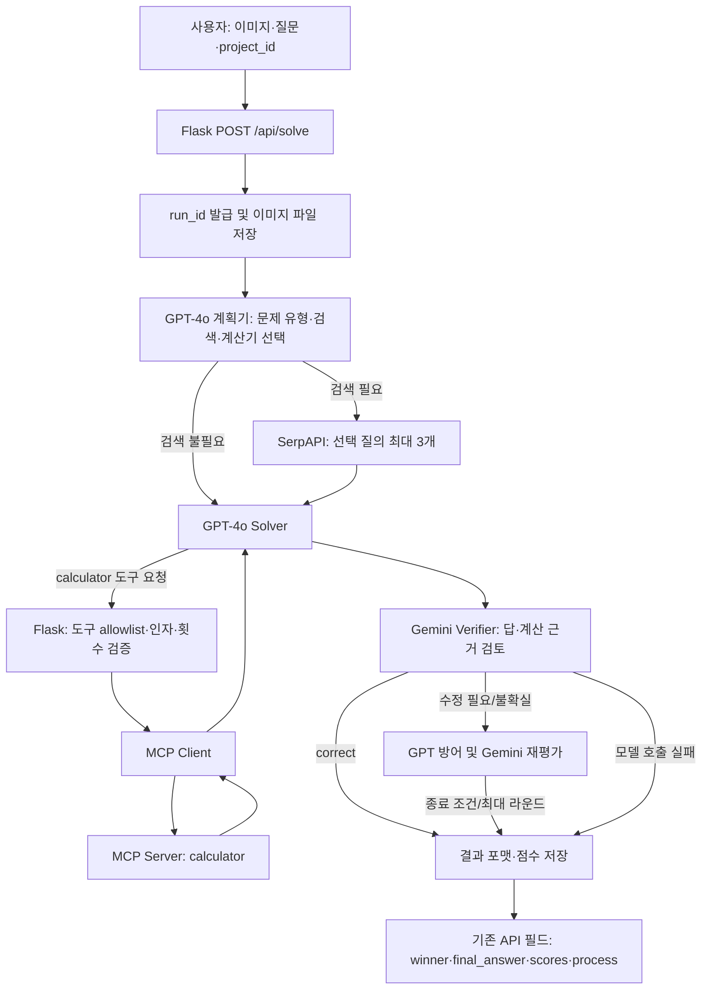

# GemPT-AI-Lab 방향·아키텍처·면접 설명서

> 이 문서는 저장소의 현재 코드와 설정을 기준으로 작성한 기술 설명서입니다. **구현됨**, **이전에 확인됨**, **현재 브랜치에서 아직 확인하지 않음**, **향후 계획**을 구분합니다. 설계가 존재한다는 사실을 실제 성능이나 배포의 증거로 표현하지 않습니다.

## 1. 프로젝트를 한 문장으로 설명하기

GemPT-AI-Lab은 문제 이미지를 받아 LLM이 문제별 실행 계획을 세우고, 필요한 경우 웹 검색과 제한된 calculator 도구를 사용한 뒤, 다른 모델의 검증과 근거를 추적 가능한 API 응답으로 반환하는 **상태 기반의 멀티모달 AI 실행 워크플로**입니다.

이 프로젝트의 목표는 “LangGraph나 Kubernetes를 넣어서 자동으로 답을 더 잘 맞히기”가 아닙니다. 기존 GemPT의 GPT 풀이·Gemini 검토 경험을 유지하면서, 모델이 어떤 행동을 선택했고 도구 결과가 어떻게 풀이에 반영됐는지 관찰 가능하게 만들고, 같은 사례를 반복해 품질과 비용을 측정할 수 있는 구조를 만드는 것입니다.

면접에서는 다음 경계를 분명히 말해야 합니다.

- **LLM 품질 향상은 가설이며 측정 결과가 아닙니다.** 현재 브랜치의 조건부 플래너와 calculator 피드백 경로는 라이브 평가 전입니다.
- **Kubernetes 매니페스트가 있다는 것과 Kubernetes 배포에 성공했다는 것은 다릅니다.** 문서상 사전 점검 때 선택된 kubectl context가 없어 클러스터 적용은 확인되지 않았습니다.
- **MCP는 계산을 더 정확하게 만드는 추론 모델이 아닙니다.** 앱과 계산 도구 서버 사이의 호출 계약과 서비스 경계를 제공합니다.

## 2. 기존 GemPT에서 무엇이 달라졌나

기존 GemPT의 핵심 경험은 GPT가 문제를 풀고 Gemini가 검토하며, 의견이 다르면 두 모델이 토론하는 것이었습니다. 기존 Flask 앱에는 이미지 업로드, 검색, 답변·점수 응답이 이미 있었습니다. 현재 저장소에는 그 기존 순차 경로를 비교 기준선으로 보존한 `run_analysis_logic_legacy`도 있습니다.

| 영역 | 기존 GemPT의 기본 접근 | GemPT-AI-Lab의 현재 방향 | 기대 효과와 한계 |
|---|---|---|---|
| 실행 흐름 | Flask 함수 안에서 여러 단계와 반복문을 순서대로 실행 | LangGraph의 상태·노드·조건부 전이로 실행 | 경로와 실패 단계를 명확히 볼 수 있습니다. 프레임워크 사용만으로 답 정확도나 속도가 개선되지는 않습니다. |
| 검색 선택 | 분류, 질의 생성, 검색, 지식 패키지를 고정 순서로 실행 | GPT-4o 계획기가 문제를 보고 검색 여부와 최대 3개 질의를 선택 | 일반 계산 문제의 불필요한 검색을 줄이는 것이 목표입니다. 계획기 호출이 하나 추가되며, 검색 판단 정확도는 평가해야 합니다. |
| 계산 | 모델이 산술 계산 도구 호출을 요청하고 앱이 결과를 전달 | 계획기가 계산기 필요 여부를 정하고, 필요하면 첫 Solver 호출에서 calculator 사용을 요구합니다. 결과는 Solver와 Verifier의 문맥에 전달됩니다. | 계산 결과를 활용한 풀이를 유도합니다. 결과를 최종 답에 제대로 반영했는지는 아직 실험으로 입증해야 합니다. |
| 도구 경계 | 초기 GemPT에서는 LLM 토론이 중심 | MCP Client와 별도 MCP Calculator Server, 입력 검증, 횟수·시간 제한을 둠 | 도구 서버를 독립 배포·교체할 수 있습니다. 네트워크 호출과 운영 복잡도는 늘어납니다. |
| 상태·복구 | 로컬 점수 JSON 및 요청 내부 상태 중심 | run ID별 LangGraph SQLite 체크포인트와 파일 기반 이미지 참조를 추가 | 중간 상태 보존 기반을 마련했습니다. 재개 API나 다중 복제본 복구 기능이 완성된 것은 아닙니다. |
| 성능 확인 | 데모 결과를 보고 판단하기 쉬움 | 고정 사례와 관측치를 JSONL로 기록하고 기준선·새 경로를 분리 집계 | 재현 가능한 평가 기반입니다. 현재 측정된 정확도나 성능 향상 수치는 없습니다. |
| 배포 | 기존 Flask 애플리케이션 중심 | Docker Compose 로컬 통합과 Kubernetes 리소스를 준비 | 재현 가능한 서비스 구성을 학습·시연할 수 있습니다. Kubernetes 클러스터 배포는 아직 확인되지 않았습니다. |

주의: `run_analysis_logic_legacy`는 “맨 처음의 원본 GemPT”와 완전히 같은 조건의 학술 기준선이 아닙니다. 이 함수는 현재 저장소 안에서 보존한 이전 순차 구현이며, MCP 등 이후 변경이 들어가 있을 수 있습니다. 따라서 비교 실험을 할 때는 두 경로의 프롬프트·모델·도구 정책도 기록하고, 오케스트레이션만 바꾼 공정한 비교인지 확인해야 합니다.

## 3. 현재 구현 흐름



**핵심 선택:** 현재 구현에서 “Agent”가 개입하는 곳은 `plan` 노드와 Solver의 function calling입니다. 그래프가 전체 실행의 상한·허용 경로·실패 종료를 통제합니다. 모델이 무제한으로 코드를 실행하거나 임의의 외부 API를 호출하지 않습니다.

### 요청을 단계별로 따라가기

1. **입력/API — Flask (`backend/app.py`)**  
   `POST /api/solve`는 multipart 요청의 `image`, 선택 `question`, 선택 `project_id`를 받습니다. 응답 계약은 기존 호환성을 위해 최상위 `winner`, `final_answer`, `scores`, `process`를 유지합니다. `/healthz`는 API 프로세스의 상태를 확인합니다.

2. **실행 식별·이미지 보관 — `image_store.py`**  
   서버가 `run_id`를 발급하고 업로드 바이트를 `/data/uploads` 아래에 저장합니다. 그래프에는 이미지 바이트나 base64 대신 `gempt-upload://<run_id>` 참조를 전달합니다. 따라서 체크포인트에 큰 바이너리를 넣지 않습니다. 보관 파일 만료 정리는 운영 작업으로 별도 호출해야 합니다.

3. **계획 — `plan` 노드 (`backend/graph.py`)**  
   GPT-4o에 질문과 이미지, JSON 출력 지시를 보냅니다. 출력에서 `subject`, `problem_type`, `needs_search`, `search_queries`, `needs_calculator`, `reason`을 읽고 필드와 검색어 개수를 제한합니다. 계획 호출이 실패하면 보수적으로 검색을 생략하고 Solver가 이어가도록 합니다. 이 fallback은 검색을 하지 않는 선택이며, 계획 결과가 맞았다는 뜻은 아닙니다.

4. **조건부 검색 — `retrieve` 노드**  
   `needs_search=true`이고 유효한 검색어가 있을 때만 실행합니다. 검색은 요청당 최대 3질의입니다. 결과를 SerpAPI가 반환한 텍스트와 출처를 포함하는 JSON 문자열로 만들고 Solver 입력에 전달합니다. 벡터 임베딩, 벡터 DB, 문서 chunk 인덱스는 없습니다. 그러므로 엄밀하게는 **검색 기반 근거 보강**이며, 벡터 RAG 파이프라인이라고 부르지 않습니다.

5. **풀이·도구 요청 — `solve` 노드**  
   OpenAI Chat Completions로 이미지와 질문, 선택 검색 결과를 전달합니다. MCP calculator 도구 스키마를 모델에 공개하고, 모델이 호출을 요청하면 그래프는 `mcp_tools`로 분기합니다. 계획기가 계산기를 필요하다고 했으면 첫 호출에서 `tool_choice="required"`로 사용을 요구하고, 이후에는 `auto`로 둡니다. 전체 calculator 호출 횟수는 최대 3회입니다.

6. **입력 검사와 계산 — Flask MCP Client → MCP Server**  
   모델 응답 자체를 실행하지 않습니다. 애플리케이션이 도구 이름 `calculator`, 인자 객체의 단일 문자열 `expression`, 호출 상한을 검사한 다음 MCP Client를 통해 서버에 요청합니다. 결과는 `solver_history`의 tool 메시지와 `calculator_checks` 상태에 저장되고, Solver가 같은 대화를 이어서 최종 풀이를 만듭니다. Gemini 검증자에게도 계산 결과 JSON을 전달합니다.

7. **검증·토론 — Gemini**  
   Gemini는 JSON Schema에 맞춰 `correct`, `correction_needed`, `uncertain` 중 하나와 비판·수정 답안을 반환하도록 요청받습니다. 결과가 확정되지 않으면 기존 GPT 방어·Gemini 재평가 흐름을 사용하며 최대 라운드 제한이 있습니다. Gemini API 호출 예외는 판정 “불확실”과 구분되는 `failure_reason`으로 기록하고, 추가 토론 호출을 하지 않고 종료합니다. 이때 GPT 초기 답은 미검증이라고 표시합니다.

8. **종료·점수·이벤트**  
   기존 점수 파일은 `project_id`별 JSON입니다. LangGraph는 `run_id`별 체크포인트를 SQLite에 기록합니다. `process`에는 Agent 계획, 검색 생략/수집, MCP 호출, 계산 반영, 검증, 오류와 점수 이벤트가 기록됩니다. `run_id`는 추적 식별자이고 `project_id`는 점수 그룹 키이므로 서로 바꿔 쓰지 않습니다.

## 4. 사용 기술과 선택 이유

| 기술 | 이 프로젝트에서의 책임 | 선택 이유 | 다른 접근과 트레이드오프 |
|---|---|---|---|
| **Python 3.12** | API, 그래프, 도구 서버 코드 | Flask·OpenAI·Google GenAI·MCP·LangGraph Python SDK를 한 언어로 통합 | 여러 언어 서비스보다 학습·통합이 단순합니다. Python 동기 서버는 높은 동시 처리량을 별도 설계해야 합니다. |
| **Flask** | 기존 HTTP API, 업로드, 점수 조회 | 기존 GemPT와 계약을 유지하고 새 그래프를 기존 경로에 연결 | FastAPI 전환은 타입 기반 API 문서나 비동기 이점을 줄 수 있지만, 본 MVP에서 프레임워크 이전은 핵심 Agent 문제와 무관한 변경 범위를 키웁니다. 현재 Flask 요청은 동기 실행입니다. |
| **OpenAI GPT-4o** | 이미지 기반 계획 및 Solver, 방어 | 기존 GPT Solver 역할을 유지하고 이미지·도구 호출 경로를 이용 | 모델 선택 자체가 오케스트레이션은 아닙니다. 현재 graph 코드에서는 `gpt-4o`가 하드코딩되어 있어 모델 교체성은 개선 대상입니다. |
| **Google Gemini / `google-genai`** | 이미지·풀이 검증, 구조화된 verdict | 기존 GemPT의 교차 검증 역할과 다른 공급자 관점을 유지 | 다른 공급자라 해도 판단 오류는 독립적이지 않습니다. Gemini 429/503 등 공급자 장애가 있을 수 있어 오류 격리와 미검증 표시가 필요합니다. 모델명은 `GEMINI_MODEL_NAME`으로 설정합니다. |
| **SerpAPI (`google-search-results`)** | 선택된 웹 검색어의 결과 수집 | 기존 검색 통합을 유지하며 실제 외부 출처 정보를 Solver에 공급 | 자체 지식베이스나 벡터 RAG보다 설정이 간단하지만, 웹 결과 품질·비용·네트워크에 의존합니다. 지금은 결과 relevance를 독립 평가하지 않습니다. |
| **LangGraph** | 계획·검색·풀이·도구·검증·종료 상태 전이 | 조건부 분기, 반복, 체크포인터를 명시적인 그래프로 나타냄 | 일반 Python 함수 체인보다 학습·상태 스키마·버전 비용이 있습니다. 단순 선형 API라면 과할 수 있습니다. 직접 사용 패키지는 LangGraph이며, LangChain `create_agent`를 사용하지 않습니다. |
| **MCP Python SDK + Streamable HTTP** | API 컨테이너와 calculator 서버 간 표준 도구 호출 | calculator를 Flask 프로세스에서 분리하고 명시된 tool 계약으로 호출 | Flask 안의 함수 호출은 더 단순하고 빠릅니다. MCP는 표준화·분리·교체성을 얻는 대신 네트워크와 초기화 지연, 장애 지점을 추가합니다. |
| **AST 기반 calculator** | 허용 산술 연산 계산 | Python `eval`을 쓰지 않고 숫자와 허용 연산자만 해석 | 현재 구현은 길이·AST 노드 수·지수·결과 크기를 제한하고 함수 호출·이름·속성 실행을 허용하지 않습니다. 이 계산기는 기호대수학이나 단위분석기는 아닙니다. |
| **SQLite + LangGraph SQLite checkpointer** | run별 그래프 상태 스냅샷 저장 | 로컬 MVP에서 별도 DB 서버 없이 checkpoint 개념을 적용 | SQLite WAL·busy timeout을 설정하지만 여러 API 복제본이 공유하는 고가용 DB 설계는 아닙니다. 현재 API는 1 replica를 전제로 합니다. |
| **JSON score file** | project별 GPT/Gemini 점수 보관 | 기존 API 동작을 보존하고 로컬 데모를 단순화 | 원자적 갱신, 동시성 제어, 다중 replica, 질의·감사 기능이 제한됩니다. 사용량이 늘면 PostgreSQL 등으로 교체해야 합니다. |
| **Docker / Compose** | API·MCP 서버의 로컬 통합 실행 | 이미지와 서비스 이름·내부 DNS·환경을 재현 가능하게 함 | Compose는 로컬 개발/통합 도구이며 클러스터 오케스트레이션이나 프로덕션 배포 플랫폼이 아닙니다. |
| **Kubernetes** | Deployment·Service·PVC·probe로 배포 형태 표현 | 컨테이너 재기동·서비스 검색·스토리지 마운트·헬스 조건을 학습·시연 | Agent 추론을 똑똑하게 만드는 기술은 아닙니다. 현재 리소스 파일은 준비됐지만 클러스터 적용·Pod Ready·서비스 호출을 관찰하지 않았습니다. |
| **React·Tailwind·MathJax / KaTeX 관련 UI 자산** | 기존 문제 입력·수식 출력 화면 | 기존 사용자 경험과 수식 표현을 유지 | Flask는 `frontend/index.html`을 제공합니다. 이 파일은 CDN React/Babel, Tailwind, MathJax를 포함하고 별도 `frontend/package.json`에는 Vite·React·KaTeX 의존성이 있습니다. Dockerfile이 npm 빌드를 수행하는 형태는 아니므로 이들이 모두 현재 서버 렌더링 경로에서 사용된다고 말하지 않습니다. |
| **pytest·pytest-mock** | Python 테스트 개발 의존성 | 향후 순수 함수·그래프 분기 테스트에 활용 가능 | 라이브 모델을 호출하는 성능 평가와 단위 테스트는 목적이 다릅니다. 이번 문서 작업에서는 테스트 실행을 하지 않았습니다. |

### 왜 LangGraph인가, 왜 LangChain이라고 부르지 않는가

LangGraph는 노드 함수가 공유 상태 일부를 갱신하고, edge가 다음 노드를 결정하는 그래프 실행 프레임워크입니다. 이 구현은 `StateGraph(GemPTState)`를 직접 만들고 `add_node`, `add_edge`, `add_conditional_edges`를 씁니다. 패키지 의존성에도 `langgraph`와 `langgraph-checkpoint-sqlite`가 있습니다.

LangChain은 모델·프롬프트·도구 통합 등을 제공하는 더 넓은 라이브러리 생태계이고, LangGraph는 그 생태계에서 상태 기반의 장기 실행·분기형 워크플로를 구성하는 별도 라이브러리입니다. 면접에서는 “LangChain Agent를 만들었다”라고 하지 말고, **“LangGraph StateGraph로 명시적 상태 머신을 구성했고 OpenAI SDK의 tool calling과 MCP SDK를 직접 연결했다”**고 설명해야 정확합니다.

## 5. AI Agent는 실제로 어디에 있나

Agent는 GPT 모델 하나의 이름이 아니라 입력을 이해하고 행동을 선택하고, 도구 결과를 보고 다음 행동을 이어 가는 애플리케이션 구조입니다.

이 프로젝트에서 Agent 행동은 두 군데입니다.

1. **실행 계획 선택:** GPT-4o가 질문·이미지를 보고 문제 유형, 검색 필요, 검색 질의, calculator 필요 여부를 정합니다. LangGraph가 이 계획을 읽고 검색 노드 또는 Solver 노드로 분기합니다.
2. **계산 도구 선택과 관찰:** Solver가 calculator tool call을 반환합니다. Flask가 유효성을 검사하고 MCP 서버를 호출합니다. 결과는 Solver에 tool result로 다시 전달되어 최종 답 생성에 쓰입니다.

하지만 이 시스템은 무제한 자율 Agent가 아닙니다. 외부 쓰기 도구가 없고, 검색 질의 수·계산 호출 수·토론 라운드를 제한하며, 가능한 상태 전이는 코드에 선언되어 있습니다. 따라서 **제한된 도구를 쓰는 LLM 기반 Agent workflow**라고 부르는 것이 가장 적절합니다.

역할이 둘이라고 독립 멀티에이전트 시스템이라고 과장할 필요도 없습니다. 현재는 하나의 LangGraph 오케스트레이터가 GPT Solver와 Gemini Verifier를 순서에 따라 호출하는 역할 분리형 워크플로입니다.

## 6. MCP 호출을 정확하게 설명하기

MCP(Model Context Protocol)는 모델이 외부 기능을 사용할 수 있도록 호스트 애플리케이션과 MCP Server가 도구 정보를 주고받고 호출하는 표준 프로토콜입니다. **LLM이 직접 MCP Server에 연결하지 않습니다.**

```text
GPT-4o: calculator(expression="21 / 3") 도구 호출 요청
        ↓
Flask Host: 도구명·JSON 인자·허용 목록·횟수 검사
        ↓
MCP Client: MCP Streamable HTTP 요청
        ↓
MCP Server: calculator 도구 실행
        ↓
구조화 결과 {"ok": true, "result": 7}
        ↓
Flask가 OpenAI 대화의 tool 결과로 추가
        ↓
GPT-4o가 결과를 반영한 풀이 계속 생성
```

서버 도구명은 `calculator`, 입력은 `{ "expression": "..." }`입니다. Python calculator는 `+`, `-`, `*`, `/`, `//`, `%`, `**`, 단항 부호만 허용합니다. 식 길이 128자, AST 64노드, 지수 절댓값 100, 결과 절댓값 `1e100` 한계를 둡니다. 임의 Python 코드 실행이나 변수명·함수 호출은 지원하지 않습니다.

MCP는 여기서 function calling과 같은 말이 아닙니다. OpenAI function calling은 **모델이 도구 호출 의도를 표현하는 형식**이고, MCP는 **앱이 별도 도구 서버와 통신하는 프로토콜**입니다. Flask가 두 경계를 연결합니다.

## 7. 배포·영속성 구조

### Docker Compose

- 서비스 `api`: Flask, 포트 5000, `/healthz`, `gempt-api:dev` 이미지
- 서비스 `mcp-tools`: MCP Streamable HTTP, 포트 8000의 `/mcp`, `/healthz`, `gempt-mcp-tools:dev` 이미지
- 내부 주소는 `http://mcp-tools:8000/mcp`
- `project-data` named volume을 `/data`에 마운트하여 점수 JSON, SQLite checkpoint, 업로드 파일의 기본 경로를 보존
- API healthcheck는 HTTP 응답을 확인합니다. 서비스 healthy는 LLM 키·모델·실제 `/api/solve` 성공을 증명하지 않습니다.

### Kubernetes

`deploy/k8s/mvp.yaml`은 `gempt` namespace, API/MCP 각각의 Deployment와 Service, ConfigMap, Secret 참조, PVC를 정의합니다. MCP는 ClusterIP 내부 서비스이고 API는 ClusterIP이며 로컬 시연 때 port-forward로 접속하는 형태입니다. readiness/liveness probe가 `/healthz`를 확인합니다.

API와 MCP를 각각 Deployment로 분리하면 서비스 독립성과 내부 DNS 연결을 보여줄 수 있습니다. 반면 프로젝트 점수는 로컬 JSON, graph checkpoint는 SQLite, 파일은 PVC에 있으므로 API를 여러 replica로 늘리는 것은 현재 persistence 설계와 맞지 않습니다. API replica 1은 현재 데모 데이터 구조에 따른 제약이지 일반 Kubernetes의 권장 replica 수가 아닙니다.

**실행 상태:** README 및 Kubernetes 문서에는 Compose 이미지 빌드, 두 컨테이너 health, 기존 API 경로에서 MCP calculator 호출이 확인됐다고 기록되어 있습니다. 그러나 새 `sophie-24` 조건부 Agent 흐름의 라이브 API 결과와 Kubernetes 배포·로그는 아직 검증 전입니다. 이 문서는 새 흐름 성공이나 Kubernetes 배포 성공을 주장하지 않습니다.

## 8. 성능과 품질은 어떻게 입증할까

현재 “기대 효과”와 “관측된 결과”를 분리해야 합니다.

### 기대하는 변화

- 일반 계산·대수 문제에서 기존의 고정 분류·질의 생성·검색·지식 패키지 호출을 피할 수 있습니다.
- 검색이 필요한 질문에만 SerpAPI를 호출해 검색 낭비와 무관한 지식 유입을 줄일 수 있습니다.
- calculator 결과를 대화 맥락과 Verifier에 제공해 산술 오류를 발견·수정할 가능성을 높입니다.
- `process`와 graph state로 어떤 분기를 탔는지 관찰할 수 있습니다.

### 반드시 함께 고려할 비용

- 계획기 호출이 OpenAI 요청 하나 추가합니다. 계산 문제에서 Gemini 검색 준비 호출은 없어지지만, 전체 비용·지연이 줄어드는지는 모델 단가·응답시간·검색 실패율을 측정해야 판단할 수 있습니다.
- 검색 경로에서는 SerpAPI 결과 지연과 검색 품질이 여전히 영향을 줍니다.
- GPT 계획이 틀리면 불필요한 검색을 하거나 필요한 검색을 생략할 수 있습니다.
- calculator 결과를 Solver에 보여도 모델이 이를 무시하거나 답의 다른 논리 오류를 남길 수 있습니다.
- Gemini 429/503과 같은 검증 서비스 장애는 답 검증을 제공하지 않습니다. 앱은 이 상태를 표시하고 토론을 멈춥니다.

### 평가 설계

`evals/cases.jsonl`은 text-only 고정 사례와 기대 답·계산기 필요 여부·검색 기대 여부·Verifier 정답을 갖습니다. 현재는 작고 인위적인 사례 집합이며 이미지 OCR/시각 이해를 대표하지 않습니다. 평가 러너는 legacy와 langgraph를 같은 case ID로 실행해 관측 JSONL을 만들고 `run_eval.py`가 지표를 집계합니다.

최소한 다음 항목을 같이 보고합니다.

| 질문 | 지표/방법 |
|---|---|
| 최종 답이 맞아졌나? | reference answer exact match와 사람 rubric 채점. 분모에 실패·무응답 포함 |
| 검색을 적절히 골랐나? | planner search decision의 accuracy·precision·recall, 실제 검색 실행 여부, 검색 결과 관련성 |
| 계산기를 적절히 골랐나? | 계획상 calculator 선택과 실제 MCP 호출의 precision·recall, 불필요 호출 및 필요 호출 누락 |
| 검증자가 오류를 잡나? | 고정된 `verifier_probe`의 기대 verdict 정확도와 false acceptance rate |
| 사용자 대기·비용은 어때? | 요청 총 지연 p50/p95, provider·SerpAPI 호출 수, token/call 비용, 재시도/오류율 |
| 이미지 문제도 개선됐나? | 실제 labeled image set, OCR/문제 추출 정확도, end-to-end answer 정확도. text-only 데이터로 대체 불가 |

현재 live runner는 요청 전체 시간을 기록하며, 문서상 모든 단계별 지연을 자동 수집하는 완성된 tracing 시스템은 아닙니다. route 정확도는 케이스 수가 충분해야 의미가 있습니다. 변경 전후 같은 이미지·질문·모델 버전으로 여러 번 실행하고, 모델 온도/프롬프트/도구 정책을 고정하거나 바뀐 요소를 명시해야 합니다. 정확도와 함께 실패·비용·지연을 보고해야 합니다.

### API의 `scores`는 무엇인가

`scores`는 확률적으로 보정된 모델 신뢰도나 실제 정답률이 아니라, 기존 GemPT의 토론 승패를 반영하는 **게임형 누적 점수**입니다. 승자가 GPT이면 라운드 `r`에서 `2^(2r)-1`, Gemini이면 `2^(2r-1)-1`점을 더하며, 합의·무승부·오류 종료는 0점입니다. 라운드가 길수록 점수가 빠르게 커지므로 “GPT가 90% 확신한다”처럼 해석하면 안 됩니다. 모델 비교 지표로 쓰려면 같은 문제 집합의 정답 기준과 별도의 calibration 평가가 필요합니다.

## 9. 파일 위치 빠른 안내

| 파일 | 면접에서 설명할 내용 |
|---|---|
| `backend/app.py` | Flask 라우트, `/api/solve` 계약, graph 의존성 구성, 이미지/체크포인터 lifecycle |
| `backend/graph.py` | 계획·검색·풀이·도구·검증 노드, 상태 기반 분기, API 오류 시 조기 종료 |
| `backend/graph_state.py` | graph 간 전달·checkpoint 대상 상태 타입 |
| `backend/workflow_services.py` | Planner/Solver/Verifier 프롬프트, 도구 스키마, verdict·점수 helper |
| `backend/mcp_client.py` | allowlist, Streamable HTTP client, timeout, 구조화 오류 변환 |
| `backend/mcp_server/server.py` | FastMCP calculator 등록, Streamable HTTP 앱, health endpoint |
| `backend/tools/calculator.py` | AST 제한 계산기와 크기·연산 경계 |
| `backend/model_clients.py` | Gemini SDK adapter, model/key 환경 변수, 민감정보를 제외한 provider 오류 |
| `backend/checkpoint_store.py` | run별 SQLite checkpointer, WAL, thread ID 설정 |
| `backend/image_store.py` | run ID 기반 검증된 이미지 파일 참조 및 원자적 저장 |
| `evals/cases.jsonl`, `evals/run_live_eval.py`, `evals/run_eval.py` | 평가 입력, 실제 관측 수집, 정확도/라우팅 집계 |
| `docker-compose.yml`, `backend/Dockerfile` | 로컬 API·MCP 컨테이너와 의존성 |
| `deploy/k8s/mvp.yaml`, `docs/kubernetes.md` | 클러스터 배포 설계와 사용 절차. 적용 증거와 구별할 것 |
| `docs/api_spec.md` | 기존 HTTP API 계약 |

## 10. 면접에서 자주 나오는 질문과 답변

### Q1. 이 프로젝트의 문제와 목표는 무엇인가요?

**답변 예시:** “이미지 문제를 LLM이 풀어도 사용자는 답과 검증 근거를 구별하기 어렵다는 점에서 출발했습니다. 기존 GPT Solver·Gemini Verifier를 유지하고, 문제 유형별로 검색과 계산 도구를 선택하게 했습니다. 실행 단계를 기록해 모델 답뿐 아니라 선택한 행동, 도구 결과, 실패 원인을 평가할 수 있는 게 목표입니다.”

### Q2. 기존 GemPT와 핵심 차이는 무엇인가요?

**답변 예시:** “기존 핵심은 GPT 풀이와 Gemini의 교차검증이었습니다. 현재 고도화에서는 LangGraph 상태 흐름, 문제별 검색·계산기 라우팅, 분리된 MCP calculator, SQLite checkpoint와 반복 평가 기반을 추가했습니다. 정답률이 올랐다고 아직 말할 수는 없습니다. 같은 입력·모델 조건의 비교 실험이 남아 있습니다.”

### Q3. Agent가 구체적으로 어디서 판단하나요?

**답변 예시:** “첫 GPT-4o Planner가 이미지와 질문을 보고 유형·검색 필요·최대 3개 검색어·계산기 필요 여부를 JSON으로 반환합니다. 그래프가 검색 노드로 갈지 결정합니다. Solver는 calculator tool call을 요청할 수 있고, 결과를 받은 대화에서 풀이를 이어갑니다. 최대 횟수와 허용 도구는 모델이 아니라 앱 코드가 제한합니다.”

### Q4. 모델이 검색을 선택하는데 그게 왜 좋아지나요?

**답변 예시:** “일반 계산에 웹 검색이 항상 필요한 것은 아닙니다. 필요 없는 검색은 지연·비용·무관한 문맥·prompt injection 위험을 늘릴 수 있습니다. 선택 검색이 이를 줄일 수 있다는 가설을 두었고, 검색 route precision/recall과 최종 답 정확도·지연을 같이 측정해야 합니다.”

### Q5. calculator 결과를 모델이 무시하면 어떻게 하나요?

**답변 예시:** “Solver 시스템 지시에서 계산기 결과를 직접 계산한 값과 대조하고 불일치 시 수정하도록 했고, 결과를 tool message로 돌려줍니다. Verifier에도 계산 결과를 전달합니다. 그래도 LLM이 결과를 무시할 수 있으므로 보장은 아닙니다. 해당 케이스를 만들어 결과 반영률을 평가하고, 필요하면 최종 답의 주장과 계산 결과를 결정적 코드로 비교하는 별도 감사 단계를 추가해야 합니다.”

### Q6. Gemini가 실패하면 어떻게 되나요?

**답변 예시:** “검증 호출 실패는 `uncertain`이라는 모델 판단으로 위장하지 않습니다. provider error metadata를 `process`에 기록하고 추가 토론을 종료합니다. GPT 초기 답을 돌려줄 때 검증되지 않았다는 사실을 표시합니다. 따라서 사용 가능한 답은 제공할 수 있어도 교차검증 성공이라고 말하지 않습니다.”

### Q7. MCP와 OpenAI tool/function calling은 뭐가 다른가요?

**답변 예시:** “OpenAI tool calling은 모델이 도구 호출을 표현하는 응답 형식입니다. MCP는 애플리케이션이 별도 도구 서버와 통신하는 프로토콜입니다. Flask가 모델 tool call을 검사한 뒤 MCP Client로 calculator 서버를 호출하고, MCP 결과를 tool result로 모델에 다시 넣습니다.”

### Q8. calculator에 Python `eval`을 쓰지 않은 이유는?

**답변 예시:** “모델이 만든 식을 Python `eval`에 넘기면 임의 코드 실행 위험이 있습니다. `ast.parse` 뒤 숫자 리터럴과 허용 연산자 노드만 직접 계산하고 문자열 길이·노드 수·지수·결과 크기를 제한합니다. 따라서 지원 문법이 좁지만 실행 가능한 기능을 통제할 수 있습니다.”

### Q9. LangGraph를 택한 이유는 무엇인가요?

**답변 예시:** “이 문제는 직선형 호출만이 아니라 검색 생략/실행, Solver↔calculator 반복, 검증 성공/수정/실패 종료가 있습니다. StateGraph로 상태와 조건부 전이를 명시하면 분기별 로그·checkpoint·테스트 경계를 드러낼 수 있습니다. 단순 선형 흐름이라면 일반 Python 함수가 더 간단합니다.”

### Q10. LangChain을 썼나요?

**답변 예시:** “직접 실행 흐름에 사용한 라이브러리는 LangGraph입니다. LangChain 생태계에 속하지만 이 구현은 LangChain의 `create_agent`나 체인을 사용하지 않습니다. OpenAI SDK tool calling, Google GenAI SDK, MCP SDK를 직접 그래프 노드에 연결했습니다.”

### Q11. Kubernetes는 Agent의 어떤 문제를 해결하나요?

**답변 예시:** “Agent 추론이나 tool selection을 개선하지 않습니다. API와 MCP 서버를 컨테이너로 실행하고 서비스 DNS, health probe, 재시작, PVC 마운트를 구성하는 배포 계층입니다. 현재는 local Kubernetes용 매니페스트까지이며 클러스터에 적용해 관찰한 상태는 아닙니다.”

### Q12. 왜 API replica가 하나인가요?

**답변 예시:** “점수는 JSON 파일, checkpoint는 SQLite, 이미지는 로컬 파일 경로에 저장합니다. 여러 Pod가 동시에 같은 파일을 업데이트하는 구조는 동시성·공유 스토리지 문제를 해결하지 못했습니다. 그래서 데모에서는 replica 1로 제한하고, 확장하려면 점수와 checkpoint를 공유 DB로 옮기는 것이 선행돼야 합니다.”

### Q13. SQLite checkpoint는 대화 기억인가요?

**답변 예시:** “아닙니다. checkpoint는 한 번의 그래프 실행 상태를 저장합니다. 프로젝트 점수 JSON과도 별개입니다. 대화 간 장기 기억, 사용자 프로필 메모리, 실행 재개 API는 현재 제품에 구현되지 않았습니다.”

### Q14. RAG를 썼다고 할 수 있나요?

**답변 예시:** “현재는 선택된 경우 SerpAPI 결과를 prompt context에 포함하는 검색 기반 근거 보강입니다. 벡터 임베딩·벡터 DB·문서 chunk 검색은 없으므로 벡터 RAG라고 설명하지 않습니다.”

### Q15. 성능이 좋아졌나요?

**답변 예시:** “아직 모릅니다. 조건부 검색은 수학 문제에서 기존 검색 호출을 줄일 수 있지만 Planner OpenAI 요청이 추가됩니다. 정확도, 불필요 검색률, 계산기 선택 및 사용률, provider 호출 수, 비용, p50/p95 지연을 같은 사례에서 측정해야 합니다. 현재 조건부 경로 라이브 결과가 없습니다.”

### Q16. 다음 기술적으로 중요한 일은 무엇인가요?

**답변 예시:** “새 graph 경로를 Mock API로 먼저 검증해 각 조건부 분기와 calculator 결과 전달을 확인하고, 이후 Gemini가 가능한 시간에 고정 사례 라이브 평가를 합니다. 그 다음 real labeled image set을 만들고 비용·지연·정확도 ablation을 진행하겠습니다. 실패 케이스의 route 판단을 고친 후에야 성능 주장을 하겠습니다.”

## 11. 60초 프로젝트 소개 예시

> “GemPT-AI-Lab은 이미지 문제를 GPT가 풀고 Gemini가 검토하는 기존 GemPT를, 행동 선택과 실행 근거를 평가할 수 있는 Agent workflow로 발전시키는 프로젝트입니다. Flask가 기존 API 계약을 유지하고, LangGraph가 문제 계획·선택 검색·풀이·도구 실행·검증 상태를 관리합니다. GPT가 산술 검산 도구를 필요로 하면 Flask가 도구 이름과 인자를 제한하고 MCP Client를 통해 별도 calculator 서버를 호출합니다. 계산 결과는 Solver와 Verifier에게 전달됩니다. 검색은 매 요청마다 실행하는 대신 planner가 필요한 경우에만 최대 세 질의를 수행합니다. SQLite checkpoint와 process 이벤트는 실행 추적 기반을 제공하고, legacy와 새 경로를 고정 사례로 비교하는 평가기를 둡니다. 현재는 조건부 Agent 경로와 Kubernetes 배포가 아직 검증되지 않아 정확도나 성능 개선을 주장하지 않고, 다음 단계에서 route 정확도·정답률·비용·지연을 측정할 계획입니다.”

## 12. 현재 상태와 남은 일

### 코드에 구현된 상태 (새 `sophie-24` 브랜치)

- GPT-4o 계획기와 검색 생략/실행 조건 분기
- 검색 결과를 Solver 문맥에 넣는 retrieve 노드, 검색 질의 상한 3
- calculator 필요 시 호출 강제, MCP 결과를 Solver 대화와 Verifier 입력에 전달
- tool allowlist, expression 검증, calculator 연산 상한
- 검색·계산기 계획 지표를 기록하는 live observation/evaluation 코드
- 기존 `/api/solve` 응답 top-level 호환성 유지

### 아직 검증하지 않은 상태

- 이 조건부 흐름으로 Docker API 컨테이너를 다시 빌드한 뒤 실제 `/api/solve`를 실행하는 것
- planner가 이미지·질문 유형별 검색·계산기 선택을 올바르게 하는지
- MCP 계산 결과가 최종 답을 실제로 교정하는 비율
- 새 경로와 legacy 간 정확도·비용·지연 비교
- labeled real-image 평가
- Kubernetes에 매니페스트를 적용하고 Pod readiness·API-to-MCP 호출·PVC persistence를 관찰하는 것

따라서 지금의 정확한 표현은 **“설계·구현을 추가했고, 기대 효과를 검증하기 위한 기록과 평가 경로를 마련했다”**입니다. “정확도가 올랐다”, “더 빠르다”, “Kubernetes에 배포했다”는 표현은 관측 자료가 생긴 뒤에 사용합니다.
